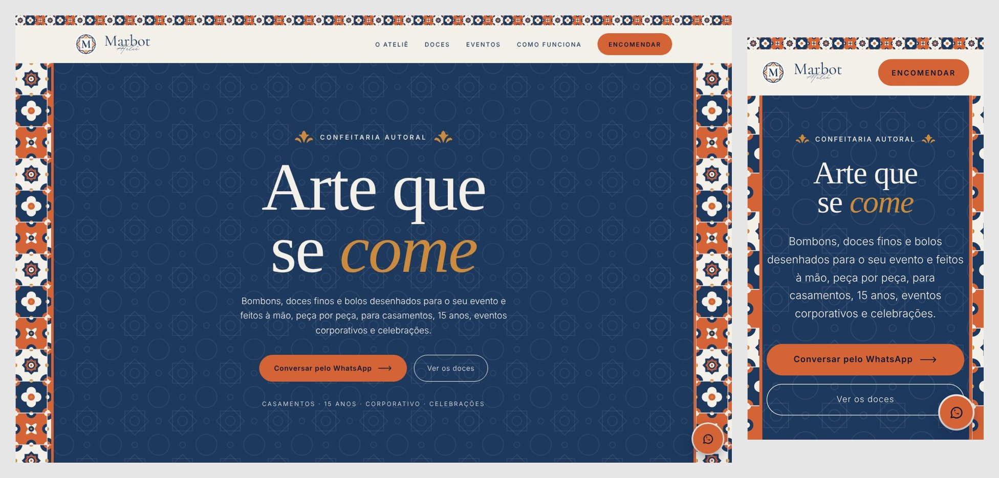
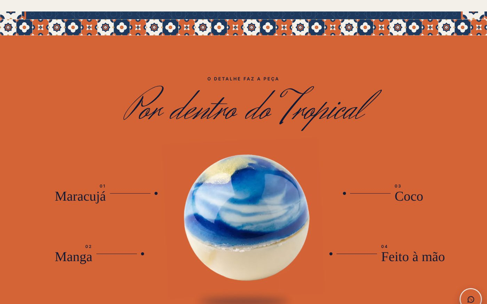
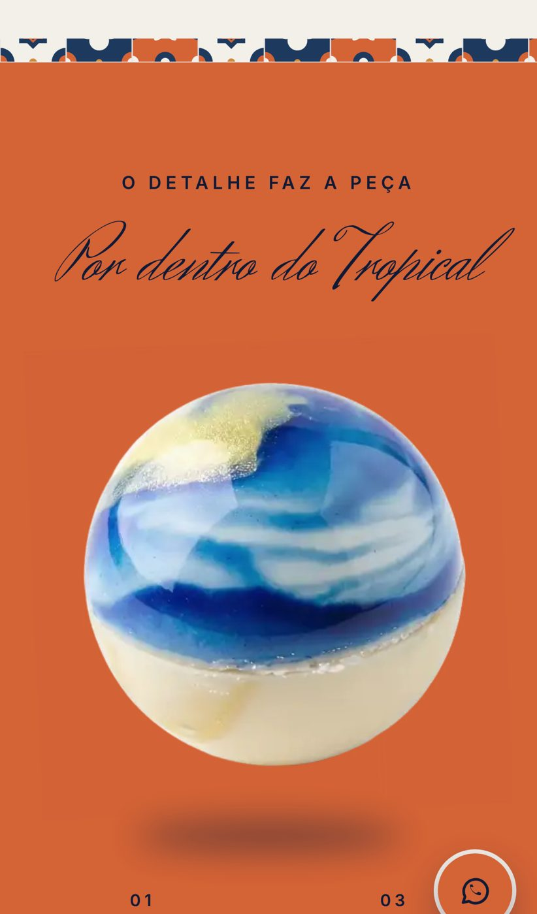
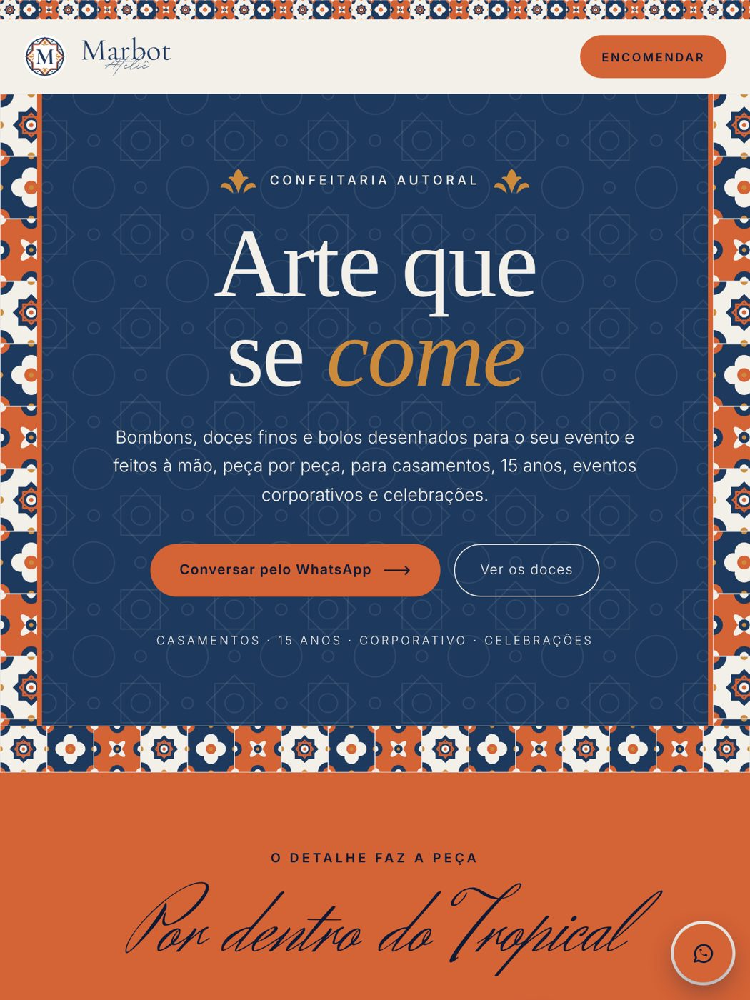
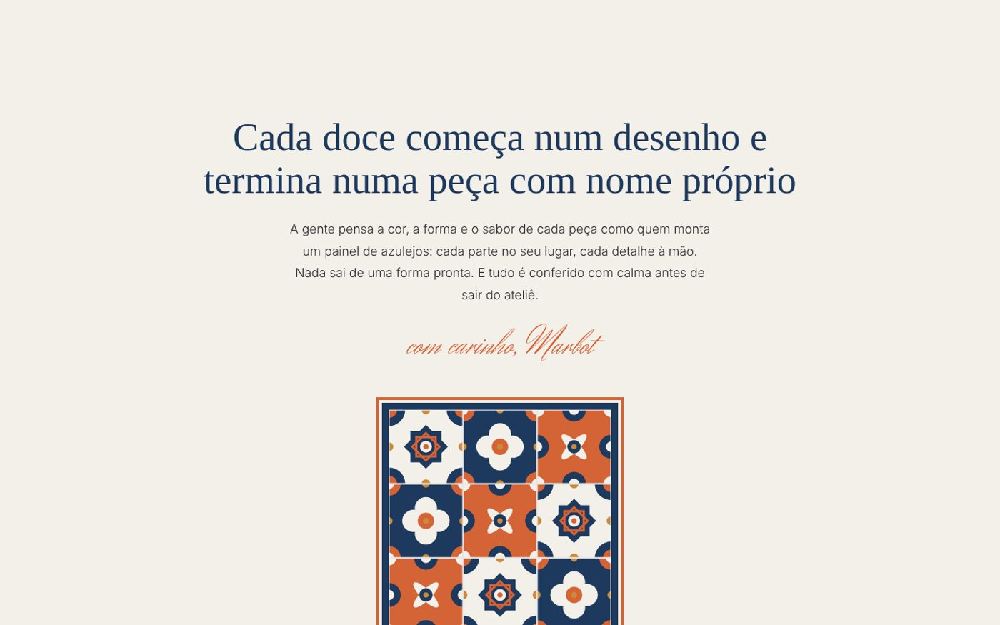
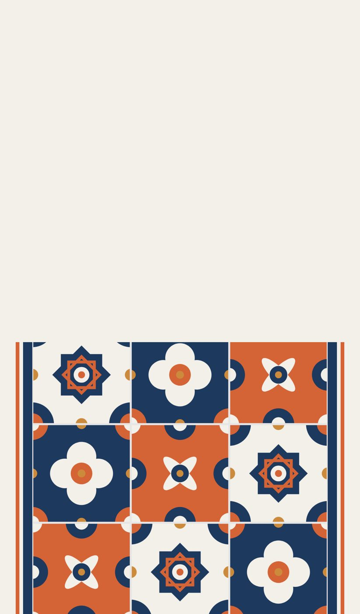

# Marbot Ateliê · Landing page feita com IA



**Site no ar:** [https://vitormarquezz.github.io/marbot-atelie-landing-page/](https://vitormarquezz.github.io/marbot-atelie-landing-page/)

Landing page da **Marbot Ateliê**, confeitaria autoral de Uberlândia (MG) que cria bombons artísticos, doces finos e bolos para casamentos, 15 anos, eventos corporativos e celebrações.

Um projeto de **marketing digital com inteligência artificial**: a identidade visual e a direção criativa são minhas, e a execução foi feita em parceria com ferramentas de IA (**Claude, Adobe Firefly, Gemini, Lovable e ChatGPT**). Este repositório mostra o resultado e o caminho até ele.

---

## Meu papel no projeto

Comecei um curso de marketing digital e quis aplicar o que estava aprendendo num projeto real: a landing page da **Marbot Ateliê**, a confeitaria da minha namorada.

**A marca nasceu comigo.** Desde a abertura da confeitaria, eu cuido da identidade visual: logotipo, cores, formas, tipografia e branding. Na landing page, levei essa identidade para a web e conduzi cada decisão de design, dos azulejos portugueses como referência ao equilíbrio entre o azul e o laranja da marca.

**O bombom girando em 360° é o destaque da página, e foi produzido por mim:** fotografia do produto, edição de imagem, edição de vídeo e uso de IA para chegar ao resultado final, sem fundo, girando em loop.

**Usei a IA como equipe, não como atalho.** Trabalhei com **Claude, Adobe Firefly, Gemini, Lovable e ChatGPT**, cada um na etapa em que rendia mais. Meu papel foi dar a direção, revisar cada entrega com olhar crítico e pedir ajustes até o resultado ficar à altura da marca, como no recorte das fotos, refeito até ficar impecável.

Este projeto está no meu portfólio para mostrar, na prática, como planejo e entrego um projeto completo com inteligência artificial: da identidade da marca ao site no ar, funcionando em qualquer aparelho.

---

## Como a IA foi usada, etapa por etapa

A tabela abaixo mostra as etapas de construção e publicação da página feitas com o Claude.

| Etapa | O que foi pedido | O que a IA fez |
|---|---|---|
| **Identidade** | Aplicar a identidade que eu criei para a marca | Organizou cores, fontes e regras de voz num design system e aplicou em toda a página |
| **Referências** | Trazer a linguagem de dois vídeos de referência | Criou o título gigante com o doce flutuando, a seção com rótulos ao redor do bombom e o carrossel de painéis coloridos com "ficha da peça" |
| **Azulejos** | Usar azulejos portugueses como referência visual | Desenhou azulejos **originais** a partir do próprio logotipo (estrela de oito pontas, flor, pétalas) e montou faixas, painéis e padrões de repetição |
| **Fotografia** | Tirar o fundo de 16 fotos de produto | Recortou as peças e refinou peça por peça: círculos ajustados à borda real das esferas, remoção de reflexos de espelho, limpeza do halo nas bordas |
| **Montagem** | Trocar o bombom fechado de duas fotos | Combinou fotos de sessões diferentes, ajustando escala, apoio e cor para parecerem uma foto só |
| **Vídeo** | Colocar na página o vídeo do bombom girando, produzido por mim | Otimizou o arquivo para a web (de 7,6 MB para menos de 1 MB) e criou uma versão animada para iPhone e Safari, que não exibem vídeo transparente |
| **Revisões** | Comentários diretamente no design | Cada comentário virou um ajuste: centralizar seções, trocar imagens, refazer a seção do Tropical |
| **Responsivo** | Ficar excelente em qualquer aparelho | Ajustou para celular pequeno, iPhone, tablet e computador e testou em 7 tamanhos de tela |
| **Publicação** | Colocar no GitHub | Converteu o design num site independente (HTML, CSS e JavaScript puros) e publicou no GitHub Pages |

## O que tem na página

- **Abertura:** "Arte que se degusta", com moldura de azulejos.
- **Por dentro do Tropical:** o bombom girando em 360°, com os sabores ao redor.
- **O ateliê** e uma faixa emocional sobre memória.
- **Carrossel de doces:** 8 peças, cada uma com foto e botão "Ver por dentro" (foto do recheio + ficha da peça). No celular, troca com o deslize do dedo.
- **Eventos, depoimentos, como funciona** e chamada final para o WhatsApp, com mensagem pronta.

## Testado em

Android (360 px), iPhone SE, iPhone 13, iPad Mini, tablet deitado (1024 px), notebook (1366 px) e monitor Full HD (1920 px): sem rolagem lateral e sem erros de JavaScript.

| Computador | Celular | Tablet |
|---|---|---|
|  |  |  |
|  |  | |

## Tecnologia

- HTML, CSS e JavaScript puros, sem framework e sem etapa de build.
- Fontes do Google Fonts: Cormorant Garamond, Herr Von Muellerhoff e Montserrat.
- Imagens em WebP; azulejos em SVG.
- Acessibilidade: textos alternativos nas imagens, foco visível no teclado, botões com no mínimo 44 px e respeito à preferência "reduzir movimento".

```
index.html          página
css/estilo.css      estilos e ajustes por tamanho de tela
js/site.js          carrossel de doces e vídeo do Tropical
assets/img/         fotos dos doces, marca e azulejos
assets/video/       bombom Tropical girando (WebM transparente + WebP animado)
docs/capturas/      imagens deste README
```

## Como abrir no seu computador

Baixe o repositório e abra o `index.html` no navegador. Ou, numa pasta com Python instalado:

```bash
python3 -m http.server 8000
# depois acesse http://localhost:8000
```

## Direitos

O código pode ser usado como referência de estudo. As **fotos, a marca, o logotipo e os azulejos** são da Marbot Ateliê e **não podem ser reutilizados** sem autorização.

Alguns textos aparecem entre colchetes de propósito: são informações que a marca ainda vai confirmar (nomes de duas peças, sabores, alergênicos e depoimentos reais). A IA foi orientada a **nunca inventar** sabores, preços, prazos ou depoimentos.
